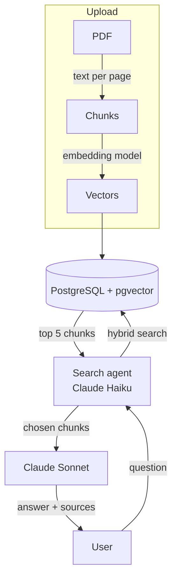

# RAG Study Tool


A RAG from scratch study tool where you upload PDFs (notes, textbook chapters) and ask questions about them. Answers only come from your documents and cite the page they came from.

## Demo

https://github.com/user-attachments/assets/6df1e282-e9a0-49f5-8735-0b36777ae76d

Try it: https://52-10-150-185.sslip.io (demo mode with a sample PDF, uploads are turned off).

## How it works



1. The PDF's text is extracted, split into chunks, embedded with sentence-transformers, and stored in PostgreSQL with pgvector.
2. A search agent (Claude Haiku) runs hybrid search (BM25 + vector search) and searches again if the results aren't good enough.
3. Claude Sonnet writes the answer from those chunks and cites the page each one came from.

## Results

I made 40 questions about CLRS Part II (chapters 6-9) and noted the page where each answer is. A question is a hit if a correct page is in the top 5 chunks.

| Search | Hit@1 | Hit@5 | MRR |
|---|---|---|---|
| Vector search | 70.0% | 87.5% | 0.777 |
| Hybrid search (BM25 + vector) | 72.5% | 92.5% | 0.800 |
| Search agent (vector search) | 97.5% | 97.5% | 0.975 |

Plain vector search missed questions about exact names, because embeddings match the general meaning of a passage, not specific terms. Hybrid search found more of them by adding BM25 keyword search. The agent did best by searching again with better words, at about $0.01 per question.

## Key decisions

- **Chunking per page:** I split each page into 1,200-character chunks with 200 characters of overlap and never split across pages, so every chunk keeps its page number for citations.
- **Hybrid search:** vector search missed exact terms like MAX-HEAPIFY, so I added BM25 keyword search and merged both result lists with reciprocal rank fusion.
- **Agent picks the evidence:** it finishes by calling a `submit_evidence` tool with the chunks it chose, so I can score it with the same eval as plain search.
- **2 models:** the agent uses Haiku because it makes several calls per question, and Sonnet only writes the final answer.

## Run it

Requirements: Docker, Node.js and an Anthropic API key.

1. Copy `backend/.env.example` to `backend/.env` and add your API key.

2. Start the database and the API:

```bash
docker compose up --build -d
```

3. Start the frontend:

```bash
cd frontend
npm install
npm run dev
```

4. Open http://localhost:5173 and upload a PDF.

Tests: `docker compose exec api python -m pytest tests -q`

Eval: `docker compose exec api python -m eval.run_eval agent` (the vector and hybrid modes are free, the agent run costs about $0.40).

## Project structure

```
backend/app/routers/        documents and query endpoints
backend/app/services/       chunking, embeddings, hybrid search, search agent
backend/app/schema.sql      database tables
backend/eval/               eval questions and script
backend/tests/              pytest tests (run in GitHub Actions on every push)
frontend/src/               React app
docker-compose.prod.yml     EC2 deployment
rag.py                      simple RAG demo
```

## References

[Code a simple RAG from scratch](https://huggingface.co/blog/ngxson/make-your-own-rag) by Xuan Son Nguyen (Hugging Face blog).
