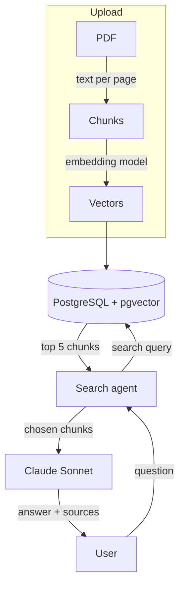

# RAG Study Tool


A study tool where you upload PDFs (notes, textbook chapters) and ask questions about them. Answers come only from your documents and link to the page they came from.

## How it works

1. When you upload a PDF, the text is extracted page by page, split into chunks and embedded with a local sentence-transformers model. The chunks and their vectors are stored in PostgreSQL with pgvector.
2. When you ask a question, a search agent (Claude Haiku) searches the chunks, rewrites the search if the results aren't good enough, and picks the chunks that answer the question.
3. Claude Sonnet writes the answer from those chunks and cites them as `[Source 1]`, `[Source 2]`.



## Results

I made 40 questions about CLRS Part II (chapters 6-9) and noted the page where each answer is. A question is a hit if a correct page is in the top 5 chunks.

| Search | Hit@1 | Hit@5 | MRR |
|---|---|---|---|
| Vector search | 62.5% | 87.5% | 0.731 |
| Search agent | 95.0% | 95.0% | 0.950 |

Plain vector search missed questions about exact names like `MAX-HEAPIFY`, because embeddings match the general meaning of a passage more than specific terms. The agent fixed most of them by searching again with better words, at about $0.01 per question.

## Key decisions

- **Chunking per page.** I split each page into 1,200-character chunks with 200 characters of overlap, and never across pages, so every chunk keeps its page number for the sources.
- **The agent picks its own evidence.** It ends by calling a `submit_evidence` tool with the chunks it chose. That gave me a list of chunks I could score with the same eval as vector search, and the sources to show in the UI. Chunk ids it never saw are ignored.
- **Two models.** The agent uses Haiku because it makes several calls per question, and Sonnet only writes the final answer.

## Run it

You need Docker, Node.js and an Anthropic API key.

1. Copy `backend/.env.example` to `backend/.env` and add your API key.
2. Start the database and the API, then the frontend:

```bash
docker compose up --build
cd frontend
npm install
npm run dev
```

Open http://localhost:5173.

Tests: `docker compose exec api python -m pytest tests -q`
Eval: `docker compose exec api python -m eval.run_eval agent` (vector search is free, the agent run costs about $0.40).

## Project structure

```
rag.py                 simple RAG demo
backend/
  app/
    routers/           documents and query endpoints
    services/          pdf_parser, chunker, embeddings, retrieval, search_agent
    schema.sql
  eval/                questions.json, run_eval.py
  tests/
frontend/
  src/                 App.jsx, components/
docker-compose.yml
```

## Things to improve

- Check that the quotes the model cites actually appear in the source.
